<p align="right">
  <strong>English</strong> · <a href="./README.ru.md">Русский</a>
</p>

<p align="center">
  
</p>

<p align="center">
  <strong>AI & SOFTWARE DEVELOPER · ENTREPRENEUR</strong><br/>
  I build digital products end to end — from product design and AI to backend development, networking, and infrastructure.
</p>

<p align="center">
  <code>AI</code> × <code>PRODUCTS</code> × <code>INFRASTRUCTURE</code>
</p>


## `> map ./bakunity`


## `> ls ./products --visual`

<p align="center">
  <a href="https://github.com/Bakunity/RDP"></a>
  <a href="https://bakvpn.me"></a>
</p>

<p align="center">
  <a href="https://github.com/Bakunity"></a>
</p>

## `> build.loop`

```text
idea → design → build → launch → improve
```

I approach every product as a connected system. The user experience, application logic, AI, backend, networks, and infrastructure all need to work together — not just in a demo, but in production.

## `> cat stack.txt`

<p align="center">
  
</p>

<p align="center">
  <code>LLMs</code> · <code>AI Agents</code> · <code>GitHub Actions</code> · <code>Docker</code> ·
  <code>Linux</code> · <code>Networking</code> · <code>Remote Systems</code> · <code>Automation</code>
</p>

## `> focus`

```text
Current focus:
├── growing Bakunity into an ecosystem of products and infrastructure
├── developing Bakunity RDP, a remote-access gateway for Windows PCs
├── developing Bak VPN as a complete networking product
├── integrating AI agents into real-world workflows
└── making infrastructure easier to manage as one connected system
```

## `> lab`

- **[Bakunity RDP](https://github.com/Bakunity/RDP)** — remote access to Windows PCs through a Linux gateway, managed via Telegram
- **[System Architect](https://github.com/TimaBak/System-Architect)** — experiments in system architecture and automation
- **[Ubuntu Hyper-V AI Server](https://github.com/TimaBak/Ubuntu-Hyperv-Hermes-Ai-Server)** — infrastructure experiments
- **[Courses](https://github.com/TimaBak/Courses)** — learning and research workspace

## `> github.matrix`

<p align="center">
  
</p>

<p align="center">
  
</p>

## `> principles`

```text
01  ship first, add complexity when needed
02  automate recurring work
03  treat infrastructure as part of the product
04  use AI to deliver measurable results
05  prioritize real-world use over polished demos
```

<p align="center">
  <a href="https://tima.biz">tima.biz</a> · <a href="mailto:i@tima.biz">i@tima.biz</a>
</p>

<p align="center">
  
</p>
