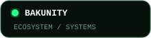
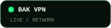
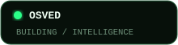
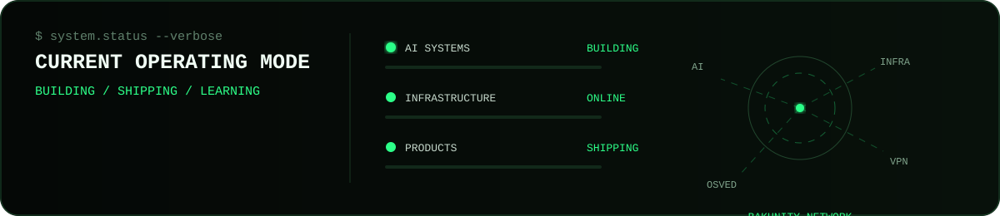
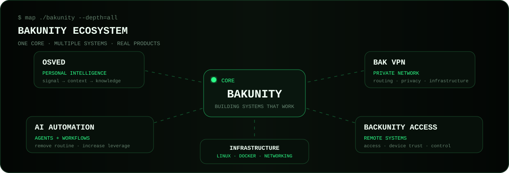
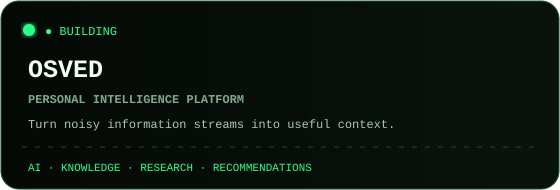
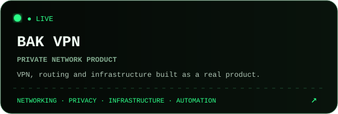
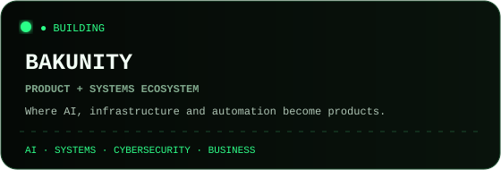
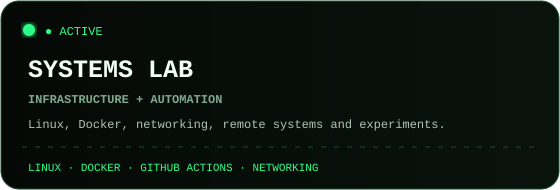

<p align="right">
  <strong>English</strong> · <a href="./README.ru.md">Русский</a>
</p>

<p align="center">
  
</p>

<p align="center">
  <a href="https://github.com/Bakunity"></a>
  <a href="https://tima.biz"></a>
  <a href="https://bakvpn.me"></a>
  <a href="https://osved.tima.biz"></a>
  <a href="https://github.com/TimaBak?tab=repositories"></a>
</p>

<p align="center">
  <strong>Founder / Builder / Systems Thinker</strong><br/>
  I turn ideas into working systems — AI, infrastructure, automation, networks and internet products.
</p>

<p align="center">
  <code>AI</code> × <code>INFRASTRUCTURE</code> × <code>AUTOMATION</code> × <code>CYBERSECURITY</code> × <code>PRODUCTS</code>
</p>



## `> map ./bakunity`



## `> ls ./products --visual`

<p align="center">
  <a href="https://github.com/TimaBak/osved"></a>
  <a href="https://bakvpn.me"></a>
</p>

<p align="center">
  <a href="https://github.com/Bakunity"></a>
  <a href="https://github.com/TimaBak/System-Architect"></a>
</p>

## `> cat mission.txt`

```text
Find a real problem.
        ↓
Build the smallest working system.
        ↓
Connect AI + software + infrastructure.
        ↓
Ship it.
        ↓
Watch what actually happens.
        ↓
Improve the system.
```

I like products that do something useful instead of existing only as demos.

## `> cat stack.txt`

<p align="center">
  
</p>

<p align="center">
  <code>LLMs</code> · <code>AI Agents</code> · <code>GitHub Actions</code> · <code>Docker</code> ·
  <code>Linux</code> · <code>Networking</code> · <code>Remote Systems</code> · <code>Automation</code>
</p>

## `> focus`

```text
/tima
├── build products, not presentations
├── automate repetitive operations
├── connect software with real infrastructure
├── explore human + AI workflows
├── design systems that can scale beyond one person
└── learn by shipping
```

## `> lab`

- **[OSVED](https://github.com/TimaBak/osved)** — personal intelligence platform
- **[System Architect](https://github.com/TimaBak/System-Architect)** — architecture and automation experiments
- **[Ubuntu Hyper-V AI Server](https://github.com/TimaBak/Ubuntu-Hyperv-Hermes-Ai-Server)** — infrastructure experiments
- **[Courses](https://github.com/TimaBak/Courses)** — learning and research workspace

## `> github.activity`

<p align="center">
  
</p>

<p align="center">
  
</p>

## `> principles`

```text
01  useful > impressive
02  systems > repetitive work
03  shipping > endless planning
04  ownership > waiting
05  learn → build → measure → repeat
```

<p align="center">
  <a href="https://tima.biz"><strong>tima.biz</strong></a>
  &nbsp;·&nbsp;
  <a href="https://github.com/Bakunity"><strong>Bakunity</strong></a>
  &nbsp;·&nbsp;
  <a href="https://bakvpn.me"><strong>Bak VPN</strong></a>
  &nbsp;·&nbsp;
  <a href="https://osved.tima.biz"><strong>OSVED</strong></a>
</p>

<p align="center">
  
</p>
