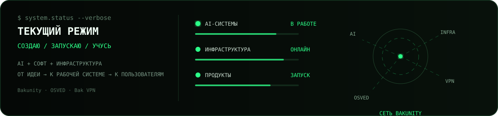
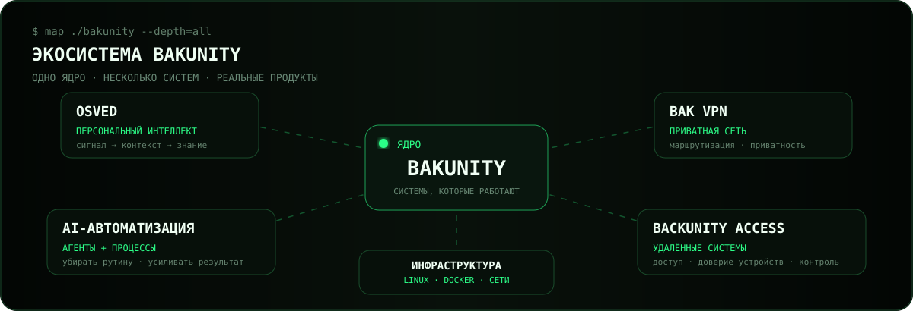
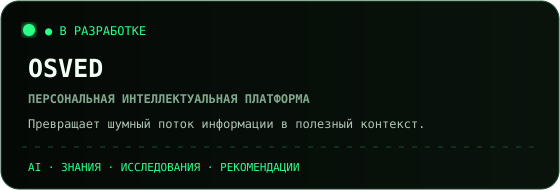
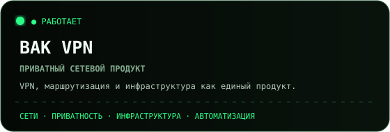
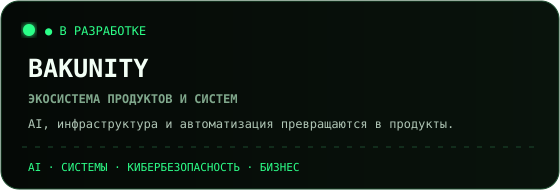
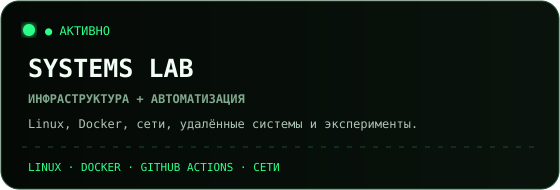

<p align="right">
  <a href="./README.en.md">English</a> · <strong>Русский</strong>
</p>

<p align="center">
  
</p>

<p align="center">
  <a href="https://github.com/Bakunity"></a>
  <a href="https://tima.biz"></a>
  <a href="https://bakvpn.me"></a>
  <a href="https://osved.tima.biz"></a>
  <a href="https://github.com/TimaBak?tab=repositories"></a>
</p>

<p align="center">
  <strong>DIGITAL SYSTEMS BUILDER</strong><br/>
  Строю цифровые продукты целиком: от идеи и интерфейса до AI, backend, сетей и инфраструктуры.
</p>

<p align="center">
  <code>AI</code> × <code>ПРОДУКТЫ</code> × <code>ИНФРАСТРУКТУРА</code>
</p>



## `> map ./bakunity`



## `> ls ./products --visual`

<p align="center">
  <a href="https://github.com/TimaBak/osved"></a>
  <a href="https://bakvpn.me"></a>
</p>

<p align="center">
  <a href="https://github.com/Bakunity"></a>
  <a href="https://github.com/TimaBak/System-Architect"></a>
</p>

## `> build.loop`

```text
идея → собрать → запустить → эксплуатировать → масштабировать
```

Мне интересен продукт как целая система: интерфейс, логика, AI, backend, инфраструктура,
сети и реальная эксплуатация — всё должно работать вместе.

## `> cat stack.txt`

<p align="center">
  
</p>

<p align="center">
  <code>LLM</code> · <code>AI-агенты</code> · <code>GitHub Actions</code> · <code>Docker</code> ·
  <code>Linux</code> · <code>Сети</code> · <code>Удалённые системы</code> · <code>Автоматизация</code>
</p>

## `> focus`

```text
Сейчас:
├── развиваю Bakunity как экосистему продуктов и инфраструктуры
├── строю OSVED — персональную интеллектуальную платформу
├── развиваю Bak VPN как полноценный сетевой продукт
├── внедряю AI-агентов в реальные процессы
└── собираю инфраструктуру так, чтобы она управлялась как система
```

## `> lab`

- **[OSVED](https://github.com/TimaBak/osved)** — персональная интеллектуальная платформа
- **[System Architect](https://github.com/TimaBak/System-Architect)** — эксперименты с архитектурой и автоматизацией
- **[Ubuntu Hyper-V AI Server](https://github.com/TimaBak/Ubuntu-Hyperv-Hermes-Ai-Server)** — инфраструктурные эксперименты
- **[Courses](https://github.com/TimaBak/Courses)** — пространство обучения и исследований

## `> github.matrix`

<p align="center">
  
</p>

<p align="center">
  <sub>Contribution Matrix · реальные GitHub-вклады + анимированная snake</sub>
</p>

<p align="center">
  
</p>

## `> principles`

```text
01  сначала запустить, потом усложнять
02  автоматизировать то, что повторяется
03  инфраструктура — часть продукта
04  AI должен давать измеримый результат
05  реальное использование важнее красивой демки
```

<p align="center">
  <a href="https://tima.biz"><strong>tima.biz</strong></a>
  &nbsp;·&nbsp;
  <a href="https://github.com/Bakunity"><strong>Bakunity</strong></a>
  &nbsp;·&nbsp;
  <a href="https://bakvpn.me"><strong>Bak VPN</strong></a>
  &nbsp;·&nbsp;
  <a href="https://osved.tima.biz"><strong>OSVED</strong></a>
</p>

<p align="center">
  
</p>
