<p align="right">
  <a href="./README.md">English</a> · <strong>Русский</strong>
</p>

<p align="center">
  
</p>

<p align="center">
  <strong>DIGITAL SYSTEMS BUILDER</strong><br/>
  Разрабатываю цифровые продукты — от интерфейсов и AI до серверной части и инфраструктуры.
</p>

<p align="center">
  <code>AI</code> × <code>ПРОДУКТЫ</code> × <code>ИНФРАСТРУКТУРА</code>
</p>


## `> map ./bakunity`


## `> ls ./products --visual`

<p align="center">
  <a href="https://github.com/Bakunity/RDP"></a>
  <a href="https://bakvpn.me"></a>
</p>

<p align="center">
  <a href="https://github.com/Bakunity"></a>
</p>

## `> build.loop`

```text
идея → разработка → запуск → развитие
```

Для меня важен результат: не отдельные прототипы, а работающие продукты, в которых интерфейс,
серверная часть, AI и инфраструктура связаны в единую систему.

## `> cat stack.txt`

<p align="center">
  
</p>

<p align="center">
  <code>LLM</code> · <code>AI-агенты</code> · <code>GitHub Actions</code> · <code>Docker</code> ·
  <code>Linux</code> · <code>Сети</code> · <code>Удалённые системы</code> · <code>Автоматизация</code>
</p>

## `> focus`

```text
Сейчас:
├── развиваю Bakunity как экосистему продуктов и инфраструктуры
├── развиваю Bakunity RDP — систему удалённого доступа к Windows
├── развиваю Bak VPN — собственный VPN-сервис
├── внедряю AI-агентов в реальные процессы
└── упрощаю управление серверами и сервисами
```

## `> lab`

- **[Bakunity RDP](https://github.com/Bakunity/RDP)** — удалённый доступ к Windows-ПК через Linux-сервер с управлением из Telegram
- **[System Architect](https://github.com/TimaBak/System-Architect)** — эксперименты с архитектурой и автоматизацией
- **[Ubuntu Hyper-V AI Server](https://github.com/TimaBak/Ubuntu-Hyperv-Hermes-Ai-Server)** — инфраструктурные эксперименты
- **[Courses](https://github.com/TimaBak/Courses)** — пространство обучения и исследований

## `> github.matrix`

<p align="center">
  
</p>

<p align="center">
  
</p>

## `> principles`

```text
01  сначала рабочее решение, затем усложнение
02  автоматизировать то, что повторяется
03  инфраструктура — часть продукта
04  AI должен давать измеримый результат
05  реальный продукт важнее эффектной демонстрации
```

<p align="center">
  <a href="https://tima.biz">tima.biz</a> · <a href="mailto:i@tima.biz">i@tima.biz</a>
</p>

<p align="center">
  
</p>
